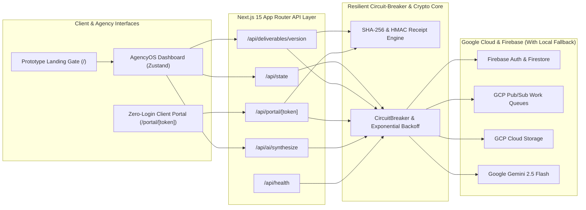

<div align="center">

# AgencyOS

**AI-Powered Client Approval, Cryptographic Version Audit & Delivery Platform for Small Content Agencies**

[](https://nextjs.org/)
[](https://www.typescriptlang.org/)
[](https://firebase.google.com/)
[](https://cloud.google.com/)
[](https://ai.google.dev/)
[](#testing--verification)
[](./LICENSE)

</div>

---

## Overview & Product Thesis

Most tools marketed to creative agencies focus on commodity *"AI content generation"* — a capability that is easy for competitors to replicate and that clients already access elsewhere.

**AgencyOS** is engineered around a much stronger operational moat: **making client feedback actionable, traceable, and impossible to lose.**

When a user first visits the application (`/`), they are greeted by a transparent **Interactive Prototype & Demonstration Gate** that explains the system architecture, lets them pre-select an organization tenant and RBAC role (`Owner`, `Manager`, `Designer`, or `Client Stakeholder`), and transitions into the full multi-module workspace via **Continue to Main Dashboard**.

---

## Core Product Differentiators

### A. One Content Inbox
Every deliverable tracks its **owner**, **deadline**, **client**, **project**, **status**, and **current version (`v1.0`, `v2.0`, `v3.0`)**. Agency managers can filter immediately by deliverables needing internal QA, client sign-off, revisions, or post-modification re-approval.
- **Interactive Visual Pin Annotations**: Click anywhere on an asset canvas to drop coordinate pins (`pinX%`, `pinY%`) tied to specific version comments.
- **Side-by-Side Version Diff Viewer**: Compare `v1.0` vs `v2.0` side-by-side along with their SHA-256 file checksums and release notes.

### B. Frictionless Client Approval Portal (`/portal/[token]`)
Clients open a secure, zero-login magic link (e.g., `/portal/tok_lumina_serum_2026`), inspect the high-resolution deliverable in **Desktop** or **Mobile Companion** mode, place visual feedback pins, and click **Approve & Sign Receipt** or **Request Revisions** — without learning the agency's internal project management tools.

### C. Version History & Cryptographic Approval Receipts
Each client decision generates an immutable `ApprovalReceipt` (`RCPT-2026-...`) signed with **HMAC-SHA256** against the exact asset version's **SHA-256 file fingerprint**.
> **Post-Approval File Modification Guardrail**: If a designer uploads a new version (`v(N+1)`) of an already-approved deliverable, AgencyOS automatically marks the prior approval receipt as `supersededByVersion: N+1`, sets `requiresReapproval: true`, pauses unreleased milestone invoices, and dispatches a re-approval alert via Google Cloud Pub/Sub.

### D. Executive Approval Bottleneck Report
Provides agency owners with real-time visibility into **pending approvals**, **overdue deliverables**, **average client response time (in hours)** ranked by stakeholder, and **revision cycle counts** per account, complete with one-click Pub/Sub escalation reminders and JSON/CSV export.

---

## System Architecture

AgencyOS is built with a **Dual-Mode Circuit-Breaker Resilience Layer** (`src/lib/resilience.ts`). When deployed with live Google Cloud & Firebase credentials, it routes operations to **Firebase Auth**, **Cloud Firestore**, **Cloud Pub/Sub**, **Cloud Storage**, and **Gemini 2.5 Flash**. When running as a self-contained demo or if an upstream cloud service experiences degradation, the circuit breaker automatically falls back to a serverless-safe local persistence and work-queue engine with zero downtime.



---

## 11 / 11 MVP Capabilities & Extended Suite

| # | Capability | Implementation Module | Status |
| :--- | :--- | :--- | :---: |
| **1** | Sign up, create an organization, and invite teammates | `firebase-client.ts`, `OrgBillingAndMvpView.tsx` | ✅ Shipped |
| **2** | Organization-level roles (`owner`, `manager`, `designer`, `client`) & tenant isolation | `firestore.rules`, `SidebarAndHeader.tsx` | ✅ Shipped |
| **3** | Create clients and projects | `ContentInboxView.tsx`, `/api/state` | ✅ Shipped |
| **4** | Upload content assets and maintain versions (`v1.0`, `v2.0`, `v3.0`) | `/api/deliverables/version`, `crypto-receipts.ts` | ✅ Shipped |
| **5** | Client review links with secure access | `/portal/[token]`, `/api/portal/[token]` | ✅ Shipped |
| **6** | Approve, reject, or request revisions with visual pin comments | `ClientPortalPreviewView.tsx`, `server-db.ts` | ✅ Shipped |
| **7** | Approval history, SHA-256 receipts, and immutable audit events | `VersionReceiptsView.tsx`, `crypto-receipts.ts` | ✅ Shipped |
| **8** | Email notifications and configurable reminders via Pub/Sub | `gcp-pubsub.ts`, `WorkflowAndQueueView.tsx` | ✅ Shipped |
| **9** | Overdue and approval turnaround bottleneck dashboard | `BottleneckReportView.tsx` | ✅ Shipped |
| **10** | Subscription checkout (`Starter`, `Growth`, `Enterprise`), billing & usage meters | `OrgBillingAndMvpView.tsx` | ✅ Shipped |
| **11** | Production deployment configs, circuit-breaker error tracking & automated tests | `Dockerfile`, `vercel.json`, `agencyos.test.ts` | ✅ Shipped |

### Extended Platform Modules Included
- **Gemini AI Feedback-to-Action Synthesizer & Autonomous Delivery Agent** (`src/components/AiCopilotStudioView.tsx`, `src/lib/gemini-copilot.ts`): Converts messy, unstructured client revision notes into categorized designer tasks (`typography`, `color`, `layout`, `copy`, `compliance`).
- **Full Drag-and-Drop Approval Workflow Builder & GCP Pub/Sub Queue Monitor** (`src/components/WorkflowAndQueueView.tsx`): Reorder approval stages, configure SLA hours, toggle SHA-256 receipt locks, and inspect live Pub/Sub topics (`agencyos-approval-events`, `agencyos-email-notifications`, `agencyos-social-publishing`).
- **Direct Instagram / LinkedIn / TikTok Publishing & Approval-Linked Milestone Invoicing** (`src/components/SocialAndInvoicingView.tsx`): Schedule approved deliverables directly to social networks and automatically unlock client milestone invoices when an approval receipt is signed.

---

## Tech Stack

- **Framework**: [Next.js 15](https://nextjs.org/) (App Router) + [React 18](https://react.dev/) + [TypeScript 5.7](https://www.typescriptlang.org/)
- **Styling & Icons**: [Tailwind CSS](https://tailwindcss.com/), [Lucide React](https://lucide.dev/), and [Material UI Icons (`@mui/icons-material`)](https://mui.com/)
- **State Management**: [Zustand 5](https://zustand-demo.pmnd.rs/)
- **Authentication & Database**: [Firebase Authentication](https://firebase.google.com/docs/auth) (Google OAuth) & [Cloud Firestore](https://firebase.google.com/docs/firestore) (`firebase` & `firebase-admin`)
- **Work Queues & Cloud Infrastructure**: [Google Cloud Pub/Sub](https://cloud.google.com/pubsub) (`@google-cloud/pubsub`), [Google Cloud Storage](https://cloud.google.com/storage) (`@google-cloud/storage`), [Google Cloud Logging](https://cloud.google.com/logging) (`@google-cloud/logging`)
- **AI Synthesis**: [Google Gemini SDK (`@google/genai`)](https://www.npmjs.com/package/@google/genai)
- **Validation & Testing**: [Zod](https://zod.dev/) & [Vitest](https://vitest.dev/)

---

## Repository Structure

```text
AgencyOS/
├── .github/workflows/
│   └── ci.yml                       # GitHub Actions CI pipeline (Typecheck, Vitest, Build)
├── public/assets/deliverables/      # High-resolution creative agency deliverable assets
├── src/
│   ├── __tests__/
│   │   └── agencyos.test.ts         # Automated Vitest suite (SHA-256 receipts, Rule C, Pub/Sub, AI)
│   ├── app/
│   │   ├── api/
│   │   │   ├── ai/synthesize/       # Gemini AI feedback-to-action endpoint
│   │   │   ├── deliverables/version/# Asset version upload & approval invalidation endpoint
│   │   │   ├── health/              # Production probe & circuit-breaker telemetry endpoint
│   │   │   ├── portal/[token]/      # Zero-login client portal lookup & receipt signing API
│   │   │   └── state/               # Tenant state synchronization & mutation API
│   │   ├── portal/[token]/page.tsx  # Standalone client review portal page
│   │   ├── globals.css              # Editorial theme variables & Tailwind directives
│   │   ├── icon.svg                 # Vector application icon
│   │   ├── layout.tsx               # Root layout wrapped in HeavyDutyErrorBoundary
│   │   └── page.tsx                 # Entry gate controller (Prototype Gate -> Main Workspace)
│   ├── components/
│   │   ├── AiCopilotStudioView.tsx  # Gemini AI feedback synthesizer & autonomous agent
│   │   ├── BottleneckReportView.tsx # Feature D: Turnaround & overdue analytics
│   │   ├── ClientPortalPreviewView.tsx # Feature B: Frictionless client portal (Desktop/Mobile)
│   │   ├── ContentInboxView.tsx     # Feature A: One content inbox, pin canvas & version diff
│   │   ├── DemoPrototypeLandingGate.tsx # Interactive prototype notice & persona selector gate
│   │   ├── ErrorBoundary.tsx        # Resilient React UI error boundary
│   │   ├── OrgBillingAndMvpView.tsx # RBAC, multi-tenant switcher, billing & 11/11 MVP matrix
│   │   ├── SidebarAndHeader.tsx     # Navigation rail, tenant switcher & prototype controls
│   │   ├── SocialAndInvoicingView.tsx # Direct social publishing & milestone invoicing
│   │   ├── VersionReceiptsView.tsx  # Feature C: SHA-256 receipts & post-approval edit audit
│   │   └── WorkflowAndQueueView.tsx # Drag-and-drop workflow builder & Pub/Sub inspector
│   ├── lib/
│   │   ├── crypto-receipts.ts       # SHA-256 asset hashing & HMAC-SHA256 receipt verification
│   │   ├── firebase-admin.ts        # Server-side Firebase Admin, GCS & Cloud Logging
│   │   ├── firebase-client.ts       # Client-side Firebase Google OAuth & resilient SSO
│   │   ├── gcp-pubsub.ts            # Google Cloud Pub/Sub publisher with local queue fallback
│   │   ├── gemini-copilot.ts        # Google Gemini AI feedback triage & heuristic fallback
│   │   ├── resilience.ts            # Circuit breaker, retry backoff & API envelope helpers
│   │   ├── seed-data.ts             # Pre-seeded multi-tenant agency dataset
│   │   └── server-db.ts             # Dual Firestore + serverless-safe local persistence engine
│   ├── store/
│   │   └── useAgencyStore.ts        # Zustand global state & optimistic action dispatchers
│   └── types/
│       └── agency.ts                # Strict TypeScript domain interfaces
├── .dockerignore
├── .env.example                     # Template for Firebase, GCP Pub/Sub & Gemini credentials
├── .gitignore
├── cloudbuild.yaml                  # Google Cloud Build -> Cloud Run deployment pipeline
├── Dockerfile                       # Multi-stage Node 22 Alpine production container
├── firebase.json                    # Firebase Hosting & Firestore security configuration
├── firestore.indexes.json           # Composite Firestore indexes
├── firestore.rules                  # Multi-tenant Firestore security & immutable receipt rules
├── next.config.mjs
├── package.json
├── tailwind.config.ts
├── tsconfig.json
├── vercel.json                      # Vercel zero-config hosting headers & build settings
└── vitest.config.ts
```

---

## Getting Started (Local Development)

### 1. Clone & Install Dependencies

```bash
git clone https://github.com/your-username/agency-os.git
cd agency-os
npm install
```

### 2. Run in Interactive Prototype Mode (Zero Config Required)

AgencyOS works out of the box without any external API keys using its built-in resilient demo engine:

```bash
npm run dev
```

Open [http://localhost:3000](http://localhost:3000) in your browser. You will land on the **Interactive Prototype & Demonstration Overview**, where you can select a persona and click **Continue to Main Dashboard**.

### 3. Testing & Verification

Run the full verification pipeline (TypeScript check, Vitest unit & integration suite, and production build):

```bash
npm test          # Run Vitest unit & integration tests
npm run typecheck # Run TypeScript compiler verification
npm run build     # Build optimized Next.js production bundle
```

---

## Hosting & Deployment Guide

This repository is pre-configured for one-click or CLI deployment across **Vercel**, **Google Cloud Run**, and **Firebase App Hosting**.

### Option A: Deploy to Vercel (Fastest for Demo & Production)
1. Push this repository to GitHub.
2. Import the repository at [vercel.com/new](https://vercel.com/new).
3. Vercel automatically detects [`vercel.json`](./vercel.json) (`npm install --legacy-peer-deps` and `npm run build`).
4. Click **Deploy** — the interactive prototype works immediately even before adding environment variables, and switches to live GCP/Firebase services as soon as variables are added in Vercel Project Settings.

### Option B: Deploy to Google Cloud Run (Containerized Production)
Using [`Dockerfile`](./Dockerfile) and [`cloudbuild.yaml`](./cloudbuild.yaml):

```bash
gcloud builds submit --config cloudbuild.yaml
```

Or deploy directly from source:

```bash
gcloud run deploy agencyos-web \
  --source . \
  --region us-central1 \
  --allow-unauthenticated
```

### Option C: Deploy to Firebase Hosting & Cloud Firestore
Using [`firebase.json`](./firebase.json) and [`firestore.rules`](./firestore.rules):

```bash
npm install -g firebase-tools
firebase login
firebase deploy --only firestore:rules,firestore:indexes,hosting
```

---

## Environment Variables (For Live Cloud Mode)

Copy [`.env.example`](./.env.example) to `.env.local` when connecting live Google Cloud and Firebase projects:

| Variable | Description | Required in Demo Mode? |
| :--- | :--- | :---: |
| `NEXT_PUBLIC_FIREBASE_API_KEY` | Firebase Web App API Key (Google OAuth) | No (Uses Resilient SSO) |
| `NEXT_PUBLIC_FIREBASE_AUTH_DOMAIN` | Firebase Auth Domain (`*.firebaseapp.com`) | No |
| `NEXT_PUBLIC_FIREBASE_PROJECT_ID` | Firebase Project ID | No |
| `FIREBASE_ADMIN_PROJECT_ID` | Server-side Firebase Admin Project ID | No |
| `FIREBASE_ADMIN_CLIENT_EMAIL` | GCP Service Account Email | No |
| `FIREBASE_ADMIN_PRIVATE_KEY` | GCP Service Account Private Key (PEM) | No |
| `GCP_PROJECT_ID` | Google Cloud Project ID for Pub/Sub & Logging | No (Uses Local Queue) |
| `GCP_PUBSUB_APPROVAL_TOPIC` | Topic for approval receipts (`agencyos-approval-events`) | No |
| `GCP_PUBSUB_NOTIFICATION_TOPIC` | Topic for email alerts (`agencyos-email-notifications`) | No |
| `GCP_PUBSUB_SOCIAL_PUBLISH_TOPIC` | Topic for social scheduling (`agencyos-social-publishing`) | No |
| `GCP_STORAGE_BUCKET` | Cloud Storage bucket for deliverable files | No |
| `GEMINI_API_KEY` | Google Gemini API Key (`@google/genai`) | No (Uses Heuristic Parser) |
| `RECEIPT_SIGNING_SECRET` | 32-byte HMAC-SHA256 secret for approval receipts | No (Has Default Secret) |

---

## License

Distributed under the **MIT License**. See [`LICENSE`](./LICENSE) for details.
